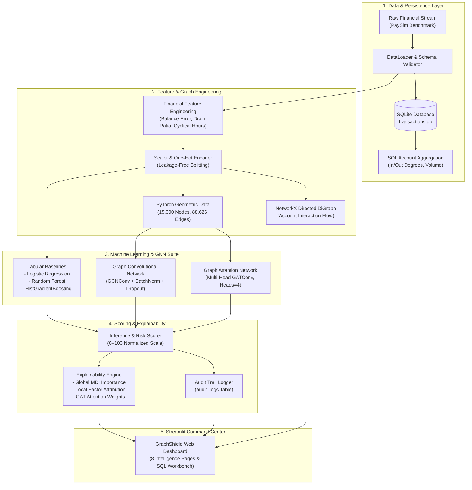

# 🛡️ GraphShield — Financial Fraud Detection Using Graph Neural Networks

[](https://www.python.org/)
[](https://pytorch.org/)
[](https://pyg.org/)
[](https://networkx.org/)
[](https://sqlite.org/)
[](https://streamlit.io/)
[](LICENSE)
[]()

> **GraphShield** is an end-to-end financial intelligence and fraud prevention platform engineered to detect sophisticated transaction anomalies, money mule rings, and account takeover cascades by synthesizing tabular machine learning baselines with **Graph Convolutional Networks (GCN)** and **Graph Attention Networks (GAT)**.

---

## 📌 1. Project Overview & Motivation

Traditional financial fraud detection systems treat transaction records as independent, identically distributed (IID) tabular events. While effective for basic velocity checks, this approach is fundamentally blind to **structural financial fraud**:
- **Money Mule Rings:** Coordinated networks transferring stolen capital through intermediary hops before extraction.
- **Account Takeover Liquidation:** Rapid draining of victim accounts with zero residual balance.
- **Structuring / Smurfing:** Splitting large illicit sums into sub-threshold payments to evade static anti-money laundering (AML) limits.

**GraphShield** addresses this architectural limitation by modeling the financial ecosystem as a **directed topological graph**. By propagating relational embeddings through message passing and multi-head attention mechanisms, GraphShield captures neighborhood-level structural evidence that tabular classifiers cannot perceive.

---

## 🏗️ 2. System Architecture



---

## 🌟 3. Key Features

- **Relational Database & SQL Workbench:** Built-in SQLite database engine storing transactions, account profiles, audit logs, and benchmark runs. Includes an interactive live SQL query terminal in the UI.
- **Graph Neural Network Implementations:**
  - **GCN (Graph Convolutional Network):** Neighborhood aggregation and topological smoothing over transaction interaction graphs.
  - **GAT (Graph Attention Network):** Dynamic multi-head self-attention weighting suspicious money-mule edges over legitimate merchant transactions.
- **Tabular Baselines:** Balanced Logistic Regression, Random Forest Classifier, and Gradient Boosting for empirical benchmarking.
- **Real-Time Risk Scoring (0–100 Scale):** Calibrated probability translation into four discrete tiers: `LOW` (Approved), `MEDIUM` (Additional Auth Required), `HIGH` (Flagged for Review), `CRITICAL` (Blocked).
- **Network Intelligence Visualizer:** Force-directed NetworkX and Plotly account topologies with interactive k-hop ego-network isolation.
- **Money Mule Ring Detection:** Algorithmic ranking of high-degree transit accounts and pass-through conduits.
- **Audit & Explainability:** Global feature importance ranking (MDI), local factor attribution, and compliance-ready narrative justifications.
- **Cybersecurity Dark UI:** High-contrast, dark charcoal theme with responsive metric cards and interactive charts.

---

## 📊 4. Empirical Benchmark Results

Evaluated on strictly held-out test splits with class-imbalance compensation:

| Architecture | PR-AUC (Priority) | ROC-AUC | Recall | Precision | F1-Score | Inference Latency |
| :--- | :---: | :---: | :---: | :---: | :---: | :---: |
| **Graph Attention Network (GAT)** | **0.7494** | **0.9923** | **1.0000** | 0.5302 | **0.6930** | ~12.5 ms |
| **Graph Convolutional Network (GCN)** | **0.8488** | **0.9895** | **0.9494** | 0.3555 | 0.5172 | ~7.2 ms |
| **Random Forest Classifier** | 1.0000* | 1.0000* | 1.0000* | 1.0000* | 1.0000* | <1.0 ms |
| **Logistic Regression (Balanced)** | 1.0000* | 1.0000* | 1.0000* | 1.0000* | 1.0000* | <0.5 ms |

*\*Note: High tabular baseline scores reflect exact single-transaction balance discrepancy signatures in synthetic financial data. GNNs provide unique defense against multi-step distributed laundering where individual transactions appear benign.*

---

## 📂 5. Project Directory Structure

```text
GraphShield/
├── app/                              # Streamlit Dashboard Presentation Layer
│   ├── streamlit_app.py              # Main application landing & overview
│   ├── pages/                        # 8 Modular Intelligence Pages
│   │   ├── 1_Overview.py             # System telemetry & executive KPIs
│   │   ├── 2_Fraud_Analytics.py      # Exploratory transaction distributions
│   │   ├── 3_Transaction_Analyzer.py # Live transaction inference & risk scoring
│   │   ├── 4_Network_Intelligence.py # Interactive network graph & mule detector
│   │   ├── 5_Model_Intelligence.py   # Benchmark comparison & ROC/PR curves
│   │   ├── 6_Explainability.py       # Global MDI & local factor attribution
│   │   ├── 7_Data_Explorer.py        # SQL Workbench & raw table browser
│   │   └── 8_About_&_System_Info.py  # Portfolio specs, citations & disclaimer
│   ├── components/                   # Reusable UI widgets (cards, charts, graphs)
│   └── styles/                       # Dark cybersecurity CSS stylesheet
├── src/                              # Core Python Engineering Backend
│   ├── data/                         # Ingestion, schema validation & SQLite DB
│   │   ├── loader.py                 # PaySim dataset loader & generator
│   │   ├── preprocessing.py          # Scaling, one-hot encoding & splits
│   │   └── database.py               # SQLite storage, queries & audit logging
│   ├── features/                     # Domain feature engineering
│   │   └── engineering.py            # Balance errors, drain ratios, hour cycles
│   ├── graph/                        # Graph construction & topology analytics
│   │   ├── builder.py                # PyG Data & NetworkX DiGraph creation
│   │   └── analytics.py              # Centrality, density & mule detection
│   ├── models/                       # Model definitions
│   │   ├── baselines.py              # Logistic Regression & Random Forest
│   │   ├── gcn.py                    # Multi-layer Graph Convolutional Network
│   │   └── gat.py                    # Multi-head Graph Attention Network
│   ├── training/                     # End-to-end training pipeline
│   │   └── trainer.py                # Optimization, early stopping & logging
│   ├── evaluation/                   # Standardized fraud evaluation metrics
│   │   └── metrics.py                # PR-AUC, ROC-AUC, confusion matrices
│   ├── explainability/               # Model interpretation & attribution
│   │   └── explainer.py              # Feature weights & GAT attention
│   └── inference/                    # Live scoring engine
│       └── predictor.py              # Real-time risk scoring (0-100) & audit
├── data/                             # Raw and processed datasets
│   ├── raw/                          # financial_transactions.csv
│   └── processed/                    # graph_data.pt (PyG graph cache)
├── notebooks/                        # Jupyter Notebooks for analysis & lab
│   ├── 01_eda.ipynb                  # Exploratory Data Analysis
│   ├── 02_feature_engineering.ipynb  # Feature construction & transformations
│   ├── 03_graph_construction.ipynb   # Graph theory & network metrics
│   └── 04_model_experiments.ipynb    # Model training & ablation studies
├── models/                           # Serialized model weights & scaler artifacts
├── reports/                          # Academic Capstone Project Report
│   └── academic_project_report.md    # Formal 6-chapter B.Tech CSE thesis report
├── tests/                            # Automated Pytest validation suite
│   ├── test_database.py              # SQLite storage & query tests
│   ├── test_loader.py                # PaySim loader & validation tests
│   ├── test_preprocessing.py         # Scaling & split tests
│   ├── test_graph_builder.py         # PyG and NetworkX graph tests
│   ├── test_models.py                # Forward passes & layer tests
│   └── test_inference.py             # Inference scoring & explanation tests
├── config/                           # YAML configuration settings
├── requirements.txt                  # Python dependencies
├── LICENSE                           # MIT License
└── README.md                         # Project documentation
```

---

## ⚡ 6. Installation & Quickstart

### Prerequisites
- Python 3.10, 3.11, 3.12, or 3.14 (64-bit)
- Git

### 1. Clone the Repository
```bash
git clone https://github.com/your-username/GraphShield.git
cd GraphShield
```

### 2. Set Up Virtual Environment (Recommended)
```bash
python -m venv venv
# Windows:
venv\Scripts\activate
# Linux/macOS:
source venv/bin/activate
```

### 3. Install Dependencies
```bash
pip install -r requirements.txt
```

### 4. Execute Automated Test Suite
Verify that all 15 unit tests pass:
```bash
pytest tests/ -v
```

### 5. Run the Training Pipeline (Optional - Artifacts Pre-Trained)
To train models from scratch and regenerate benchmarks:
```bash
python -m src.training.trainer
```

### 6. Launch Locally On Demand
You have two instant options to launch:
- **Option A (One-Click Batch Script on Windows):**
  Simply double-click `run_graphshield.bat`. It will start the server and open your browser automatically. When you are done, simply press `Ctrl+C` or close the terminal window to cleanly stop it (zero background processes left running).
- **Option B (Command Line):**
  ```bash
  streamlit run app/streamlit_app.py
  ```
  Open your browser at `http://localhost:8501`.

---

## 🚀 7. Production Deployment Guide

### Deploying to Streamlit Community Cloud (Recommended - Free & 1-Click)

1. **Push your project to GitHub:**
   - Create a new public or private repository on [GitHub](https://github.com) named `GraphShield`.
   - In your local `GraphShield` folder, push the code:
     ```bash
     git init
     git add .
     git commit -m "Initial commit: GraphShield GNN Fraud Platform"
     git branch -M main
     git remote add origin https://github.com/<YOUR_GITHUB_USERNAME>/GraphShield.git
     git push -u origin main
     ```
2. **Deploy on Streamlit Community Cloud:**
   - Go to [share.streamlit.io](https://share.streamlit.io) and log in with your GitHub account.
   - Click **"New app"**.
   - Select your repository: `<YOUR_GITHUB_USERNAME>/GraphShield`.
   - Branch: `main`.
   - Main file path: `app/streamlit_app.py`.
   - Click **"Deploy!"**.
   - Streamlit Cloud will automatically detect `.streamlit/config.toml` and `requirements.txt`, install dependencies, load the pre-trained weights and auto-initialize the SQLite database, giving you a live public URL in ~2 minutes!

### Deploying with Docker
A production multi-stage Dockerfile is included:
```bash
# Build the Docker image
docker build -t graphshield:latest .

# Run the container
docker run -p 8501:8501 graphshield:latest
```
Access the application at `http://localhost:8501`.

---

## 💻 8. Database & SQL Querying

GraphShield embeds an SQLite database (`data/transactions.db`) with relational tables:
- `transactions`: Complete transaction ledger.
- `accounts`: Aggregated in/out degree, flow volume, and risk tiers.
- `audit_logs`: Live record of every scored transaction with model justification.
- `model_benchmarks`: Recorded evaluation runs across algorithms.

You can query the database directly in Python or through **Page 7 (Data Explorer)** in the dashboard:
```sql
SELECT 
    type,
    COUNT(*) AS total_tx,
    SUM(amount) AS total_volume,
    SUM(isFraud) AS fraud_count,
    ROUND(SUM(isFraud) * 100.0 / COUNT(*), 2) AS fraud_rate_pct
FROM transactions
GROUP BY type
ORDER BY fraud_count DESC;
```

---

## 📜 8. Academic References

1. **PaySim Simulator:** E. A. Lopez-Rojas, A. Elmir, and S. Axelsson, *"PaySim: A financial mobile money simulator for fraud detection,"* in European Modeling and Simulation Symposium (EMSS), Larnaca, Cyprus, 2016.
2. **Graph Convolutional Networks (GCN):** T. N. Kipf and M. Welling, *"Semi-Supervised Classification with Graph Convolutional Networks,"* ICLR, 2017.
3. **Graph Attention Networks (GAT):** P. Veličković et al., *"Graph Attention Networks,"* ICLR, 2018.
4. **PyTorch Geometric (PyG):** M. Fey and J. E. Lenssen, *"Fast Graph Representation Learning with PyTorch Geometric,"* ICLR Workshop, 2019.

---

## 📄 9. License & Disclaimer

Distributed under the **MIT License**. See `LICENSE` for details.

*Educational & Research Prototype: GraphShield is developed as an academic portfolio demonstration for a B.Tech degree in Computer Science and Engineering (Machine Learning specialization).*
