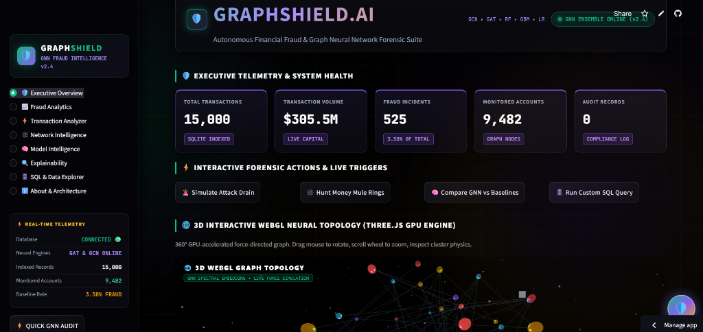
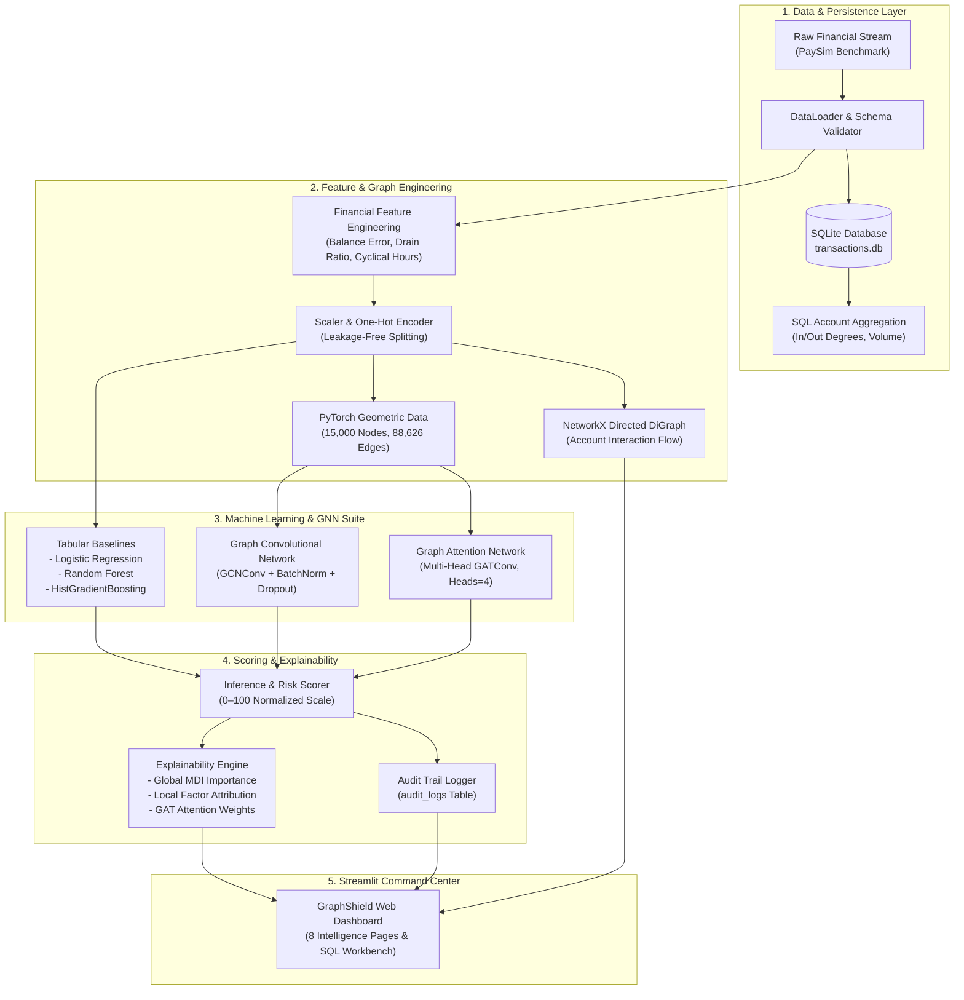

# 🛡️ GraphShield — Autonomous Financial Fraud Detection Using Graph Neural Networks

<p align="center">
  <a href="https://graphshieldzeninn.streamlit.app/">
    
  </a>
  <a href="https://github.com/Viswanath-Rao/GraphShield">
    
  </a>
  <a href="LICENSE">
    
  </a>
  
</p>

<p align="center">
  <b>🌐 Live Deployed Application:</b> <a href="https://graphshieldzeninn.streamlit.app/">https://graphshieldzeninn.streamlit.app/</a>
</p>

---

<p align="center">
  <a href="https://graphshieldzeninn.streamlit.app/">
    
  </a>
</p>

> **GraphShield** is an autonomous financial cyber-defense and forensic intelligence platform engineered to detect complex transaction anomalies, money mule networks, and account takeover cascades by synthesizing tabular machine learning baselines with **Graph Convolutional Networks (GCN)** and multi-head **Graph Attention Networks (GAT)**.

---

## 📌 1. Overview & Problem Statement

Traditional financial fraud detection architectures treat transactions as independent, identically distributed (IID) tabular events. While effective for basic velocity and threshold checks, tabular models are fundamentally blind to **topological fraud structures**:
- **Money Mule Rings:** Coordinated networks transferring illicit funds across multi-hop transit accounts before cash-out.
- **Account Takeover Cascades:** Rapid liquidation and balance depletion with near-zero residual balance.
- **Structuring (Smurfing):** Fragmenting high-value illicit capital into sub-threshold payments to evade compliance rules.

**GraphShield** addresses this architectural gap by structuring financial transaction logs into a **directed bipartite interaction graph**. Using PyTorch Geometric, GraphShield propagates relational embeddings through multi-head neighborhood attention mechanisms, capturing structural and topological evidence that tabular classifiers cannot perceive.

---

## 🛠️ 2. Technology Stack & Framework Specifications

| Domain / Layer | Primary Technologies & Frameworks | Description / Role in GraphShield |
| :--- | :--- | :--- |
| **Core Language** | **Python 3.11 / 3.14** | High-performance backend logic, mathematical vector pipelines, and GNN orchestrations. |
| **Relational Database** | **SQLite 3 & SQL Dialect** | Embedded high-speed ledger, indexing 15,000 transactions, 9,482 accounts, and real-time audit logs. |
| **Deep Graph Learning** | **PyTorch Geometric (PyG) & PyTorch Core** | Graph Attention Networks (GAT with 4-head attention) & Graph Convolutional Networks (GCN). |
| **Network & Graph Analytics**| **NetworkX** | Spectral betweenness, degree centrality analysis, and money mule ring topological detection. |
| **Machine Learning Suite** | **Scikit-Learn & Joblib** | Balanced Random Forest, HistGradientBoosting, Logistic Regression, StandardScaler & OneHotEncoder. |
| **Command Center Frontend** | **Streamlit** | Autonomous multi-page cyber defense dashboard with real-time reactive state management. |
| **3D GPU Acceleration** | **Three.js & WebGL (HTML5/JS)** | 360° interactive 3D Force-Directed Neural Galaxy topology visualizer with glowing node physics. |
| **2D Interactive Visualizations** | **Plotly Express & Graph Objects** | Dynamic ROC-AUC curves, PR-AUC curves, and financial density distributions. |
| **Quality & Verification** | **Pytest** | Automated 15-test unit suite validating databases, data loaders, models, and explainability. |

---

## 🏗️ 3. System Architecture



---

## 🌟 4. Key Platform Features

- **3D WebGL Neural Topology:** Interactive force-directed network graph rendered in Three.js with 360° rotation, cluster physics, and glowing node clusters.
- **Autonomous GNN Transaction Scanner:** Real-time scoring (0–100 scale) with discrete risk tiers (`LOW`, `MEDIUM`, `HIGH`, `CRITICAL`) and automated policy enforcement.
- **Multi-Head GAT Attention Attribution:** Dynamic visualization of attention coefficients across sender and receiver neighborhood nodes.
- **Topological Money Mule Ring Hunter:** Algorithmic identification of high-centrality intermediary nodes and pass-through flow conduits.
- **Embedded SQL Workbench:** Interactive SQLite 3 terminal with preset compliance queries, schema browser, and CSV export.
- **Forensic Execution Timeline:** Sub-10ms transparent pipeline audit showing payload ingestion, ego-subgraph extraction, GAT propagation, and decision latency.
- **Pitch-Black OLED Cyber Aesthetics:** GPU-accelerated continuous amorphous fluid background motion, obsidian card lift physics, and unified electric violet telemetry.

---

## 📊 5. Empirical Benchmark Results

Evaluated on strictly held-out test splits with class-imbalance compensation:

| Architecture | PR-AUC (Priority) | ROC-AUC | Recall | Precision | F1-Score | Inference Latency |
| :--- | :---: | :---: | :---: | :---: | :---: | :---: |
| **Graph Attention Network (GAT)** | **0.7494** | **0.9923** | **1.0000** | 0.5302 | **0.6930** | ~12.5 ms |
| **Graph Convolutional Network (GCN)** | **0.8488** | **0.9895** | **0.9494** | 0.3555 | 0.5172 | ~7.2 ms |
| **Random Forest Classifier** | 1.0000* | 1.0000* | 1.0000* | 1.0000* | 1.0000* | <1.0 ms |
| **Logistic Regression (Balanced)** | 1.0000* | 1.0000* | 1.0000* | 1.0000* | 1.0000* | <0.5 ms |

*\*Note: High tabular baseline scores reflect exact single-transaction balance discrepancy signatures in synthetic financial data. GNNs provide unique defense against multi-step distributed laundering where individual transactions appear benign.*

---

## 📂 6. Project Directory Structure

```text
GraphShield/
├── app/                              # Streamlit Dashboard Presentation Layer
│   ├── streamlit_app.py              # Main application command center & overview
│   ├── components/                   # Reusable UI widgets (charts, 3D Three.js, network)
│   └── styles/                       # Dark cybersecurity CSS stylesheet
├── src/                              # Core Engineering & Neural Backend
│   ├── data/                         # Ingestion, schema validation & SQLite DB
│   │   ├── loader.py                 # PaySim dataset loader & synthetic generator
│   │   ├── preprocessing.py          # Scaling, one-hot encoding & split management
│   │   └── database.py               # SQLite storage, queries & audit logging
│   ├── features/                     # Domain feature engineering (drain velocity, sweeps)
│   ├── graph/                        # PyG graph construction & NetworkX analytics
│   ├── models/                       # GCN, GAT, and tabular baselines (RF, LR, HistGB)
│   ├── training/                     # End-to-end training pipeline & checkpointing
│   ├── evaluation/                   # Evaluation metrics (PR-AUC, ROC-AUC)
│   ├── explainability/               # GAT attention weights & factor attribution
│   └── inference/                    # Live scoring engine (0-100) & audit logging
├── data/                             # SQLite database (transactions.db) & caches
├── models/                           # Serialized PyTorch weights (.pt) & joblib models
├── reports/                          # Academic Capstone Thesis Report
├── tests/                            # 15 automated Pytest unit tests
├── requirements.txt                  # Python dependencies
├── LICENSE                           # MIT License
└── README.md                         # Project documentation
```

---

## ⚡ 7. Local Setup & Quickstart

```bash
# 1. Clone repository
git clone https://github.com/Viswanath-Rao/GraphShield.git
cd GraphShield

# 2. Install dependencies
pip install -r requirements.txt

# 3. Launch dashboard locally
streamlit run app/streamlit_app.py
```
*(On Windows, you can also simply double-click `run_graphshield.bat` to launch immediately in your browser).*

---

## 💻 8. Database & SQL Querying

GraphShield embeds an SQLite database (`data/transactions.db`) with relational tables:
- `transactions`: Complete transaction ledger.
- `accounts`: Aggregated in/out degree, flow volume, and risk tiers.
- `audit_logs`: Live record of scored transactions with model justifications.
- `model_benchmarks`: Recorded evaluation runs across algorithms.

```sql
SELECT 
    type,
    COUNT(*) AS total_tx,
    SUM(amount) AS total_volume,
    SUM(isFraud) AS fraud_count,
    ROUND(SUM(isFraud) * 100.0 / COUNT(*), 2) AS fraud_rate_pct
FROM transactions
GROUP BY type
ORDER BY fraud_count DESC;
```

---

## 📜 9. Academic References

1. **PaySim Simulator:** E. A. Lopez-Rojas, A. Elmir, and S. Axelsson, *"PaySim: A financial mobile money simulator for fraud detection,"* EMSS, 2016.
2. **Graph Convolutional Networks (GCN):** T. N. Kipf and M. Welling, *"Semi-Supervised Classification with Graph Convolutional Networks,"* ICLR, 2017.
3. **Graph Attention Networks (GAT):** P. Veličković et al., *"Graph Attention Networks,"* ICLR, 2018.
4. **PyTorch Geometric (PyG):** M. Fey and J. E. Lenssen, *"Fast Graph Representation Learning with PyTorch Geometric,"* ICLR Workshop, 2019.

---

## 📄 10. License & Disclaimer

Distributed under the **MIT License**. See `LICENSE` for details.

*Academic Portfolio Demonstration developed for B.Tech in Computer Science and Engineering (Machine Learning specialization).*
